# ECSデプロイの役割分担: 案1・案2・案3

## 目的

Docker imageをECRへ送り、ECSを更新するまでの処理を、GitHub ActionsとAWS CodeBuildのどちらが担当するか比較する。3案とも同じJava Hello Worldアプリ、同じDockerfile、同じECRリポジトリ、同じECS構成を使う想定。

## 案1: CodeBuildがイメージを作り、ActionsがECSをデプロイ

現在の実装方式。基盤リソース投入とアプリデプロイは別ワークフローに分かれているが、イメージビルド/ECR pushはCodeBuild、ECSアプリのCloudFormation更新はActionsが担当する。

```mermaid
flowchart LR
    A[mainへの変更] --> B[GitHub Actions]
    B --> B1[prod承認・AWS認証]
    B1 --> B2[CodeBuildをcommit SHAで起動]
    B2 --> C[CodeBuildがソース取得]
    C --> C1[Java/JARをビルド]
    C1 --> C2[Docker imageをビルド]
    C2 --> C3[ECRへpush]
    C3 --> D[ActionsがCodeBuild成功を待つ]
    D --> D1[CloudFormationでECSを更新]
    D1 --> E[ECSサービス安定化・URL表示]
```

- **GitHub Actions**: 基盤ワークフローでCodeBuild/ECS基盤を作成し、アプリワークフローで承認・CodeBuild起動・完了待ち・ECSアプリCloudFormation更新を行う。
- **CodeBuild**: ソース取得、JAR作成、Docker build、ECR push。
- **受け渡すもの**: commit SHA。CodeBuildはCodeConnections経由でそのSHAを取得する。
- **良い点**: ActionsにDockerビルド環境を用意せず、CodeBuildにビルド処理を集められる。
- **注意点**: ActionsのOIDCロールにもECSデプロイ権限が必要。CodeBuildとActionsの両方にAWS権限を設定する。

## 案2: Actionsがイメージを作り、CodeBuildがECSをデプロイ

CIをGitHub Actions、CDの実行をCodeBuildに分ける方式。

```mermaid
flowchart LR
    A[mainへの変更] --> B[GitHub Actions CI]
    B --> B1[Java/JARをビルド]
    B1 --> B2[Docker imageをビルド]
    B2 --> B3[ECRへpush]
    B3 --> C[prod承認]
    C --> D[ActionsがCodeBuildを起動]
    D --> D1[image URI/digestとSHAを渡す]
    D1 --> E[CodeBuildがデプロイ定義を取得]
    E --> E1[CloudFormationでECSを更新]
    E1 --> F[CodeBuildが結果を返す]
    F --> G[ActionsがURLを表示]
```

- **GitHub Actions**: Java/Docker build、テスト、ECR push、承認、CodeBuild起動と完了待ち。
- **CodeBuild**: 渡されたイメージを使ってECSを更新。Docker buildは行わない。
- **受け渡すもの**: ECR image digestまたはURIとcommit SHA。
- **良い点**: CIのログやPull Request検証をGitHub Actionsにまとめつつ、AWSデプロイ権限をCodeBuild側へ分離できる。
- **注意点**: Actions runnerにJava/Docker環境とECR push権限が必要。ビルド済みイメージを再ビルドせず、そのままデプロイする。

## 案3: Actionsは成果物を渡し、CodeBuildがイメージ作成からECS更新まで行う

ActionsでJARを作って検証し、CodeBuildにJARとコミット情報を渡す方式。JARはS3の受け渡し用バケットに置く。CodeBuildは同じコミットのDockerfileとECSテンプレートを取得し、Docker image作成・ECR push・ECS更新を担当する。

```mermaid
flowchart LR
    A[Pull Request] --> B[Actionsでテスト]
    B --> C[mainへの変更]
    C --> D[GitHub Actions]
    D --> D1[Java/JARをビルド・検証]
    D1 --> D2[JARを受け渡し用S3へ配置<br/>SHA・object keyを記録]
    D2 --> D3[prod承認後にCodeBuild起動]
    D3 --> E[CodeBuildが同じSHAのDockerfile/テンプレートを取得]
    E --> E1[S3からJARを取得]
    E1 --> E2[Docker imageをビルド]
    E2 --> E3[ECRへpush]
    E3 --> E4[CloudFormationでECSを更新]
    E4 --> F[CodeBuild結果をActionsへ返す]
    F --> G[ActionsがURLを表示]
```

- **GitHub Actions**: テスト、JAR作成、成果物S3へのアップロード、承認、CodeBuild起動と完了待ち。
- **CodeBuild**: JARと同じコミットのDockerfileを使ったDocker build、ECR push、ECS CloudFormation更新。
- **受け渡すもの**: S3 bucket/key、object versionまたはSHA-256、commit SHA。GitHub ActionsのartifactをCodeBuildが直接参照するのではなく、CodeBuildから読めるS3を受け渡し場所にする。
- **良い点**: Java/JARの作成とテストをActionsで行い、AWS内のDocker build・ECR push・ECS更新をCodeBuildへ集約できる。
- **注意点**: 成果物S3、暗号化、保存期間、削除ルール、CodeBuildのS3読み取り権限が追加で必要。Actionsで検証したJARとCodeBuildで使うJARが同一であることを、object versionやchecksumで確認する。

## 3案の比較

| 比較項目 | 案1: CBビルド / Actionsデプロイ | 案2: Actionsビルド / CBデプロイ | 案3: Actions成果物 / CBビルド・デプロイ |
|---|---|---|---|
| Java/JARを作る場所 | CodeBuild | GitHub Actions | GitHub Actions |
| Docker imageを作る場所 | CodeBuild | GitHub Actions | CodeBuild |
| ECR push担当 | CodeBuild | GitHub Actions | CodeBuild |
| ECS更新担当 | GitHub Actions | CodeBuild | CodeBuild |
| Actionsから渡すもの | commit SHA | image digest/URI、commit SHA | S3 object情報、checksum、commit SHA |
| 主な成果物受け渡し | GitHubからCodeBuildがcheckout | ECR | S3からCodeBuildがJARを取得 |
| 強いAWS権限を持つ主体 | ActionsとCodeBuildの両方 | 主にCodeBuild | 主にCodeBuild |
| Actions側に必要な環境 | AWS認証とデプロイ処理 | Java、Docker、ECR認証 | JavaとS3へのアップロード |
| 追加設定の多さ | 中 | 中 | 多 |
| 向く状況 | ビルドはAWSに置き、デプロイ制御はActionsに残したい | GitHubでCIを完結させ、AWS権限をCodeBuildへ分離したい | 検証済みJARをそのままAWS側のDocker buildへ渡したい |

## どの案を選ぶか

- 現行構成は **案1**。基盤投入とアプリデプロイのワークフローは分離し、CodeBuildがDocker imageを作成・push、ActionsがECSアプリスタックを更新する。
- ActionsにDocker buildを任せ、CodeBuildをデプロイ専用にするなら **案2**。単純なECS更新だけなら、ActionsがCloudFormationを直接呼ぶ方が構成要素は少ない。
- ActionsのJava検証済みJARをAWS側へ渡し、Docker build以降をCodeBuildへまとめるなら **案3**。S3での成果物受け渡しとchecksum確認が増える。
- どの案でも、デプロイ時には信頼済みmainのcommit SHAを固定し、ECRのdigestまたはS3 object versionで同一成果物を追跡する。

## 共通の注意事項

- GitHub ActionsからCodeBuildを起動する段階で `prod` 承認を済ませる。承認前にデプロイ用CodeBuildを動かさない。
- CodeBuild service roleは実行する案に合わせて最小権限にする。CodeBuildのbuildspecはAWS権限を持つコマンドとして扱い、信頼済みブランチから取得する。
- CodeBuildをVPCへ接続する場合は、GitHub、ECR、CloudFormationなど必要な通信経路を確保する。VPC接続しない構成では、外部または社内のprivate endpointへ到達できるかを別途確認する。
- Actions側のIAMロールに残す権限とCodeBuild service roleへ移す権限を、案の選択後に合わせて見直す。
