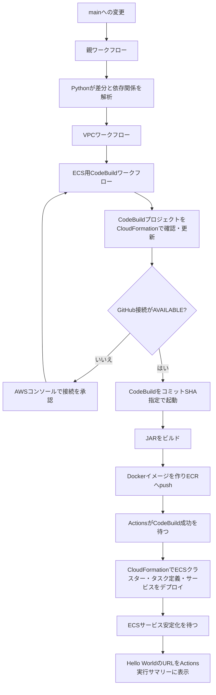

# ECSイメージをCodeBuildで作る処理フロー

## 目的

既存のGitHub ActionsによるECSビルド・デプロイ方式を残したまま、別の deploy-ecs-codebuild.yml でイメージビルドをAWS CodeBuildへ移す。親の依存関係プランからは、引き続きECSリソースとして順次実行する。

## フロー

## ワークフローごとの責務

### .github/workflows/deploy-aws-resources.yml — 親ワークフロー

- 変更パスから対象リソースと前提リソースを特定する。
- .github/deploy/dependency.yml の依存順で子ワークフローを順次起動する。
- ECSの変更ではVPCを先に実行し、その後 deploy-ecs-codebuild.yml を起動する。

### .github/workflows/deploy-ecs-codebuild.yml

- prod 環境で承認を受けてAWS OIDCロールを引き受ける。
- CodeBuild用CloudFormationスタックを作成・更新する。
- GitHub接続が AVAILABLE であることを確認する。
- 対象コミットSHAを指定してCodeBuildを開始し、成功まで待つ。
- 成功後にイメージURIとコミットタグをECS CloudFormationスタックへ渡す。
- ECSが安定したら、タスクのパブリックIPを使ったURLを実行サマリーへ出す。

### CodeBuildプロジェクトと .github/ecs/buildspec.yml

- GitHub App接続を使って対象コミットを取得する。
- Java 21でJARを生成し、Dockerイメージを構築してECRへpushする。
- CodeBuildサービスロールは、対象リポジトリの読み取り、対象ECRリポジトリへのpush、専用CloudWatch Logsへの書き込みに限定する。
- CodeBuildは専用VPCに接続せず、GitHubとコンテナレジストリへの通信にNAT Gatewayを必要としない。

## 一度だけ必要なGitHub接続承認

CloudFormationで作成されるCodeConnectionsは初期状態が PENDING となる。初回のワークフローは接続状態を確認し、未承認ならAWSコンソールのConnections画面へのリンクをActionsサマリーに出して停止する。

AWSコンソールでGitHub Appを接続し、対象リポジトリだけにアクセスを許可した後、親ワークフローを再実行する。接続が AVAILABLE になればCodeBuildが続行する。

## IAM権限と適用手順

### 適用状態

GitHub ActionsのOIDCロール `ra-men-role` に、インラインポリシー `DeployEcsCodeBuild` を適用済み。ポリシー全文は [.github/iam/policies/deploy-ecs-codebuild.json](../.github/iam/policies/deploy-ecs-codebuild.json) に保存する。

### 実行手順

1. AWS IAMでロール `ra-men-role` を開き、信頼ポリシーがGitHub ActionsのOIDCを許可していることを確認する。
2. IAMロールの「許可」からインラインポリシー `DeployEcsCodeBuild` を追加する。JSONエディタに上記ファイルの全文を貼り付けて保存する。
3. 新しいワークフローを実行し、CloudFormationがCodeBuildプロジェクト、GitHub接続、専用サービスロールを作成することを確認する。
4. 初回はAWSコンソールのDeveloper Tools > Settings > ConnectionsでGitHub接続を承認し、対象リポジトリだけにアクセスを許可する。
5. 親ワークフローを再実行する。接続が `AVAILABLE` なら、ビルド後にECSがデプロイされる。

### `DeployEcsCodeBuild` が許可する操作

- **CloudFormation**: 指定したCodeBuild/ECSスタックとそのChange Setの確認・実行・削除。テンプレート検証とテンプレート概要の取得は `Resource: *`。
- **CodeBuild**: `eiei-mun-ecs-codebuild-project` の作成・更新・削除、ビルド開始・状態確認・停止。
- **CodeConnections**: GitHub接続作成はARNが作成前に決まらないため `Resource: *`。既存接続の確認・削除・タグ操作は同じAWSアカウント/リージョンの接続ARNに限定。
- **IAM**: `eiei-mun-ecs-codebuild-service-role` の作成・削除・信頼/インラインポリシー管理とCodeBuildへのPassRole。既存 `ecsTaskExecutionRole` はECSタスクへのPassRoleのみ。
- **ECS**: 指定したプロトタイプクラスター、タスク定義、サービスの作成・更新・削除と状態確認。タスク一覧・詳細取得は `Resource: *`。
- **EC2ネットワーク**: VPC/セキュリティグループ/ネットワークインターフェースの参照は `Resource: *`。セキュリティグループ作成はap-south-1かつNameタグが `eiei-mun-ecs-prototype*` の要求に限定し、変更/削除は同じNameタグのグループに限定。
- **CloudWatch Logs**: 指定されたCodeBuild/ECSロググループの作成・削除・保持期間・書き込み操作。ロググループ一覧の参照は `Resource: *`。

GitHub Actions用ロールとCodeBuildサービスロールは別の役割を持つ。前者はデプロイ操作を行い、後者はソース取得、ECR push、ビルドログ書き込みを行う。

## 現在の扱い

この方式は既存ワークフローとは別ファイルで追加する。依存関係定義を新しいワークフローへ切り替えた後、親ワークフローのECS実行がCodeBuild方式を使う。deploy-ecs-hello-world.yml は比較・切り戻し用に残す。
