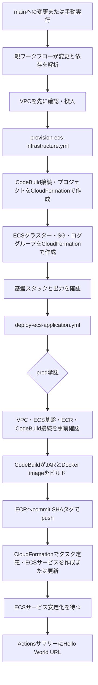

# ECS基盤構築とアプリデプロイ

## 目的

ECS作業を、長期間使うAWS基盤の作成と、その基盤を使うアプリケーションのリリースに分ける。

- 基盤ワークフローはCodeBuildプロジェクト/接続とECSクラスター、タスク用セキュリティグループ、ロググループを作成・更新する。
- アプリデプロイワークフローは、基盤が期待どおり稼働していることを確認してから、CodeBuildでイメージを作り、タスク定義とECSサービスを作成・更新する。
- ECS基盤が不完全なら、アプリのビルド・デプロイへ進まず停止する。

## 処理フロー

## ワークフローの分担

### `.github/workflows/provision-ecs-infrastructure.yml` — AWS基盤の投入

- 既存VPCスタックの状態と出力を確認する。
- CodeBuildプロジェクト、GitHub接続、CodeBuildサービスロールをCloudFormationスタック `eiei-mun-ecs-codebuild` で作成・更新する。
- ECSクラスター、専用セキュリティグループ、アプリ用ロググループをCloudFormationスタック `eiei-mun-ecs-infrastructure` で作成・更新する。
- 基盤スタックの完了状態とクラスターの `ACTIVE` 状態、必要な出力を確認する。
- GitHub接続が未承認のときも基盤作成自体は完了扱いにし、AWSコンソールの承認リンクをActionsサマリーに出す。
- アプリのタスク定義とECSサービス、イメージビルドは作らない。

### `.github/workflows/deploy-ecs-application.yml` — アプリのデプロイ

- `prod` 環境の承認後、基盤スタックが `CREATE_COMPLETE` または `UPDATE_COMPLETE` であることを確認する。
- VPCとサブネットの組み合わせ、ECSクラスターの `ACTIVE` 状態、セキュリティグループ、ロググループ、ECRリポジトリ、CodeBuildプロジェクト、GitHub接続が準備済みか検証する。
- 前提が欠けている場合はCodeBuild起動前に停止し、不足リソース名を示す。
- 対象コミットSHAでCodeBuildを起動し、Java/JARとDocker imageをビルドしてECRへpushする。
- CloudFormationスタック `eiei-mun-ecs-application` でタスク定義とECSサービスだけを作成・更新する。基盤リソースは作成・更新しない。
- ECSサービスが安定した後、タスクのパブリックIPを使うURLをActionsサマリーに出す。

### 親ワークフローの依存順

`.github/deploy/dependency.yml` はECSを次の2リソースに分けている。

1. `ecs-infrastructure`: VPCに依存し、基盤ワークフローを実行。
2. `ecs-application`: VPCと `ecs-infrastructure` に依存し、アプリデプロイを実行。

アプリのソース変更では、親ワークフローが先に基盤ワークフローを実行し、次にアプリをデプロイする。基盤スタックがすでに存在する場合、CloudFormationは差分なしで完了し、基盤チェック後にアプリへ進む。アプリワークフローを単独で手動実行する場合も、同じ前提チェックを行う。

## 初回の実行手順

1. IAMポリシー `DeployEcsCodeBuild` を [.github/iam/policies/deploy-ecs-codebuild.json](../.github/iam/policies/deploy-ecs-codebuild.json) の最新版へ更新する。今回、CodeBuild/ECS基盤・アプリのスタック名とサブネット確認権限が追加されている。
2. PRをマージする。変更パスによって親ワークフローが基盤からアプリの順で実行する。必要ならActionsから `Provision ECS infrastructure` を手動実行して、基盤だけを先に作ることもできる。
3. 基盤実行後にAWSコンソールでクラスター、セキュリティグループ、ロググループとVPC接続を確認する。
4. GitHub接続が `PENDING` の場合、AWSコンソールのDeveloper Tools > Settings > Connectionsで承認する。許可対象は `azulazulazula/github-action-pub` のみにする。
5. `Deploy ECS application` の承認待ちを開き、基盤が期待どおりであることを確認してから承認する。
6. アプリワークフローの事前確認を通過するとCodeBuildとECSデプロイが進む。完了時のActionsサマリーでURLを確認する。

## 既存リソースの扱い

- 新しいスタック名は `eiei-mun-ecs-infrastructure` と `eiei-mun-ecs-application`。既存のモノリシックな `eiei-mun-ecs-prototype` スタックをこの変更で更新・削除しない。
- 既存の手動作成ECSサービス/クラスターも自動停止しない。古いサービスが稼働中だと新サービスと二重にタスク料金が発生するため、初回デプロイ前に稼働状況を確認する。
- ECSアプリの `DesiredCount` は1で、デプロイ後も継続稼働する。テスト後に停止する場合は、アプリスタックから先に削除する。
- この構成はブラウザ確認用としてHTTP 80番をインターネットへ公開する。TLS/認証はないため、テスト用のHello World以外を載せない。
- CodeBuild接続承認待ちでアプリが停止した場合、基盤スタックを削除せず、接続を承認してアプリワークフローを再実行する。

## IAMの役割

- GitHub Actionsロール `ra-men-role`: CodeBuild/基盤スタックの作成・確認、CodeBuild起動、事前検証、アプリスタックのCloudFormation更新に必要な権限。
- CodeBuildサービスロール: GitHubソース取得、ECR push、CloudWatch Logs書き込み。ECSリソースの作成・更新は行わない。
- ECSタスク実行ロール: コンテナイメージ取得とCloudWatch Logs書き込み。CodeBuildロールとは別にする。

## 注意事項

- IAMポリシーJSONはこの分割に合わせて更新したが、AWS CLIセッションが失効しているため、AWS側の `ra-men-role` への反映はまだ確認・更新できていない。新しいワークフローを実行する前に手順1を実施する。
- 既存の `.github/workflows/deploy-ecs-hello-world.yml` は比較用の手動ワークフローとして残る。親の依存プランは新しい基盤/アプリの2ワークフローを呼ぶ。
- ECRにはコミットごとのイメージが残る。継続利用する場合はECRライフサイクルルールを設定する。
