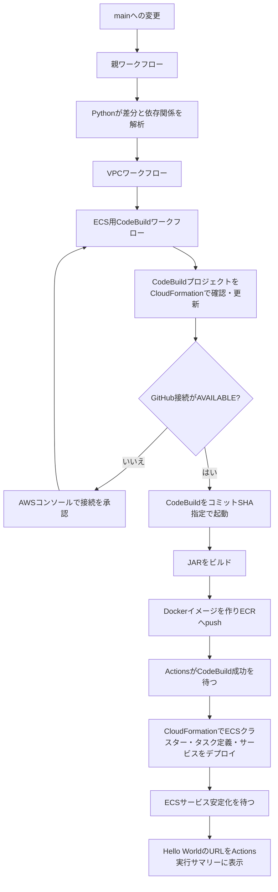

# ECSイメージをCodeBuildで作る処理フロー

## 目的

既存のGitHub ActionsによるECSビルド・デプロイ方式を残したまま、別の deploy-ecs-codebuild.yml でイメージビルドをAWS CodeBuildへ移す。親の依存関係プランからは、引き続きECSリソースとして順次実行する。

## フロー

## ワークフローごとの責務

### .github/workflows/deploy-aws-resources.yml — 親ワークフロー

- 変更パスから対象リソースと前提リソースを特定する。
- .github/deploy/dependency.yml の依存順で子ワークフローを順次起動する。
- ECSの変更ではVPCを先に実行し、その後 deploy-ecs-codebuild.yml を起動する。

### .github/workflows/deploy-ecs-codebuild.yml

- prod 環境で承認を受けてAWS OIDCロールを引き受ける。
- CodeBuild用CloudFormationスタックを作成・更新する。
- GitHub接続が AVAILABLE であることを確認する。
- 対象コミットSHAを指定してCodeBuildを開始し、成功まで待つ。
- 成功後にイメージURIとコミットタグをECS CloudFormationスタックへ渡す。
- ECSが安定したら、タスクのパブリックIPを使ったURLを実行サマリーへ出す。

### CodeBuildプロジェクトと .github/ecs/buildspec.yml

- GitHub App接続を使って対象コミットを取得する。
- Java 21でJARを生成し、Dockerイメージを構築してECRへpushする。
- CodeBuildサービスロールは、対象リポジトリの読み取り、対象ECRリポジトリへのpush、専用CloudWatch Logsへの書き込みに限定する。
- CodeBuildは専用VPCに接続せず、GitHubとコンテナレジストリへの通信にNAT Gatewayを必要としない。

## 一度だけ必要なGitHub接続承認

CloudFormationで作成されるCodeConnectionsは初期状態が PENDING となる。初回のワークフローは接続状態を確認し、未承認ならAWSコンソールのConnections画面へのリンクをActionsサマリーに出して停止する。

AWSコンソールでGitHub Appを接続し、対象リポジトリだけにアクセスを許可した後、親ワークフローを再実行する。接続が AVAILABLE になればCodeBuildが続行する。

## PRマージ後の実行手順

現在、CodeBuildスタックとECSスタックはまだAWSに作成されていない。IAMポリシー `DeployEcsCodeBuild` は `ra-men-role` に適用済み。次の順で環境を作成する。

1. PR #24をマージする。マージできない場合は、先にGitHubが示す競合を解消する。
2. `main` への更新で親ワークフローが起動したことをActionsで確認する。GitHubの `prod` 環境承認が表示されたら承認する。
3. 親ワークフローは依存順にVPCを確認したあと、`deploy-ecs-codebuild.yml` を実行する。ここでCloudFormationスタック `eiei-mun-ecs-codebuild` が作成され、GitHub接続・CodeBuildプロジェクト・専用ロール・ロググループが用意される。
4. 初回は接続が `PENDING` のため、接続確認ステップでワークフローが停止する。これは想定された停止で、ECSスタックはまだ作成されない。Actionsのステップサマリーに表示されるConnectionsリンクを開く。
5. AWSコンソールのDeveloper Tools > Settings > Connectionsで対象接続を開き、GitHub Appを承認する。許可対象は `azulazulazula/github-action-pub` のみにする。接続状態が `AVAILABLE` になったことを確認する。
6. GitHub Actionsから失敗した親ワークフローを再実行する。CodeBuildが対象コミットを取得し、JARとコンテナイメージを作成してECRへpushする。
7. ビルド成功後、CloudFormationスタック `eiei-mun-ecs-prototype` が作成または更新され、ECSサービスが安定するまで待つ。
8. 完了したActions実行のサマリーで `Hello World URL` を開き、応答を確認する。

初回実行は接続承認で止まるため、そのまま再実行せず、先にAWSコンソールで承認を完了する。2回目以降は接続が `AVAILABLE` のままなので、通常はビルドからECSデプロイまで進む。

## IAM権限と適用手順

### 適用状態

GitHub ActionsのOIDCロール `ra-men-role` に、インラインポリシー `DeployEcsCodeBuild` を適用済み。ポリシー全文は [.github/iam/policies/deploy-ecs-codebuild.json](../.github/iam/policies/deploy-ecs-codebuild.json) に保存する。

### 実行手順

1. AWS IAMでロール `ra-men-role` を開き、信頼ポリシーがGitHub ActionsのOIDCを許可していることを確認する。
2. IAMロールの「許可」からインラインポリシー `DeployEcsCodeBuild` を追加する。JSONエディタに上記ファイルの全文を貼り付けて保存する。
3. 新しいワークフローを実行し、CloudFormationがCodeBuildプロジェクト、GitHub接続、専用サービスロールを作成することを確認する。
4. 初回はAWSコンソールのDeveloper Tools > Settings > ConnectionsでGitHub接続を承認し、対象リポジトリだけにアクセスを許可する。
5. 親ワークフローを再実行する。接続が `AVAILABLE` なら、ビルド後にECSがデプロイされる。

### `DeployEcsCodeBuild` が許可する操作

- **CloudFormation**: 指定したCodeBuild/ECSスタックとそのChange Setの確認・実行・削除。テンプレート検証とテンプレート概要の取得は `Resource: *`。
- **CodeBuild**: `eiei-mun-ecs-codebuild-project` の作成・更新・削除、ビルド開始・状態確認・停止。
- **CodeConnections**: GitHub接続作成はARNが作成前に決まらないため `Resource: *`。既存接続の確認・削除・タグ操作は同じAWSアカウント/リージョンの接続ARNに限定。
- **IAM**: `eiei-mun-ecs-codebuild-service-role` の作成・削除・信頼/インラインポリシー管理とCodeBuildへのPassRole。既存 `ecsTaskExecutionRole` はECSタスクへのPassRoleのみ。
- **ECS**: 指定したプロトタイプクラスター、タスク定義、サービスの作成・更新・削除と状態確認。タスク一覧・詳細取得は `Resource: *`。
- **EC2ネットワーク**: VPC/セキュリティグループ/ネットワークインターフェースの参照は `Resource: *`。セキュリティグループ作成はap-south-1かつNameタグが `eiei-mun-ecs-prototype*` の要求に限定し、変更/削除は同じNameタグのグループに限定。
- **CloudWatch Logs**: 指定されたCodeBuild/ECSロググループの作成・削除・保持期間・書き込み操作。ロググループ一覧の参照は `Resource: *`。

GitHub Actions用ロールとCodeBuildサービスロールは別の役割を持つ。前者はデプロイ操作を行い、後者はソース取得、ECR push、ビルドログ書き込みを行う。

## 運用上の注意点

### 公開範囲

- ECSテンプレートはタスクにパブリックIPを割り当て、セキュリティグループでTCP 80番を `0.0.0.0/0` に公開する。URLを知っている人は誰でもHTTPでアクセスでき、TLSや認証はない。テスト用のHello Worldだけを置き、機密情報や実データを載せない。
- タスクを入れ替えるとパブリックIPが変わることがある。以前のURLが開けなくなった場合は、最新のActions実行サマリーにあるURLを使う。
- タスクの外部公開をやめる場合は、セキュリティグループの接続元を必要なIP範囲に制限するか、公開経路を別途設計する。

### 継続費用と後片付け

- ECSサービスの `DesiredCount` は1で、デプロイ後もタスクを継続稼働させる。テストが終わって使わない場合は、CloudFormationから `eiei-mun-ecs-prototype` スタックを削除してタスクを停止する。
- 削除する場合はECSスタックから先に削除する。VPCスタックは他のリソースが利用していないことを確認してから削除する。
- CodeBuildプロジェクトはビルド時に料金が発生し、ECRにはコミットごとのイメージが残る。現状、ECRのライフサイクルルールはこの構成では管理していないため、長く使う場合は古いイメージの保存上限を設定する。
- 以前作成した手動ECSサービス/クラスターはこのCloudFormationスタックでは停止しない。両方のサービスが稼働するとFargateタスクが重複するため、不要な方を個別に停止・整理する。

### 再現性と失敗時

- CodeBuildは対象コミットのSHAでビルドする。初回接続承認で止まった場合はCodeBuildスタックを消さず、GitHub接続を承認して同じ親ワークフローを再実行する。スタックを削除して作り直すと、新しいGitHub接続の再承認が必要になる。
- ECS用イメージはコミットSHAでタグ付けされる。一方、Nginxサイドカーは `nginx:alpine` という可変タグを使うため、将来の再デプロイで別のNginxイメージが取得される可能性がある。継続運用する前に固定バージョンまたはイメージdigestへ変更する。
- デプロイ失敗時はActionsログだけでなく、該当CloudFormationスタックのイベント、ECSサービスイベント、CloudWatch Logsを確認する。CloudFormationのロールバック中に同じスタックを手作業で変更せず、ロールバック完了後に原因を直して再実行する。

### 変更承認とIAM範囲

- CodeBuildスタックは名前付きIAMロールを作るため、デプロイに `CAPABILITY_NAMED_IAM` が必要。ワークフローにはこの指定を追加済み。
- `DeployEcsCodeBuild` は対象プロトタイプの作成・更新に加え、一部のスタック/リソース削除権限も持つ。レビュー済みのmain変更だけをデプロイするよう、GitHubのmain保護と `prod` 環境の承認設定を維持する。
- IAMポリシーには、接続作成、テンプレート検証、タスク・ネットワーク情報の参照など `Resource: *` の権限がある。接続の削除権限は同じAWSアカウント・リージョン内の接続ARNを対象にするため、このロールをほかの用途へ流用しない。

## 現在の扱い

この方式は既存ワークフローとは別ファイルで追加する。依存関係定義を新しいワークフローへ切り替えた後、親ワークフローのECS実行がCodeBuild方式を使う。deploy-ecs-hello-world.yml は比較・切り戻し用に残す。
