# ECSのDockerイメージを作る場所の違い

この文書は、GitHub Actions上でDockerイメージを作る方式と、AWS CodeBuild上で作る方式を比較する。どちらの方式でも、最終的なイメージは同じECRリポジトリへ送られ、ECSへのデプロイはGitHub Actionsが行う。

## 既存方式: GitHub Actionsのランナーでビルド

```mermaid
flowchart LR
    A[GitHub mainへの変更] --> B[親ワークフロー]
    B --> C[build-jar job<br/>GitHub-hosted runner]
    C --> C1[Java 21でJARを作成]
    C1 --> C2[Actions artifactへ保存]
    C2 --> D[deploy job<br/>別のGitHub-hosted runner]
    D --> D1[JAR artifactを取得]
    D1 --> D2[AWS OIDCで認証]
    D2 --> D3[Docker build]
    D3 --> D4[ECRへpush<br/>commit SHAタグ]
    D4 --> D5[CloudFormationでECSを更新]
    D5 --> E[ECSサービス安定化・URL表示]
```

- JavaのコンパイルとJAR作成、Dockerイメージ作成はGitHub-hosted runner上で行う。
- JARはActions artifactとして一度アップロードされ、次のjobでダウンロードされる。
- GitHub ActionsがECRへログインしてpushし、そのままECSスタックもデプロイする。

## 新方式: AWS CodeBuildでビルド

```mermaid
flowchart LR
    A[GitHub mainへの変更] --> B[親ワークフロー]
    B --> C[VPC依存を先に処理]
    C --> D[deploy-ecs-codebuild job<br/>GitHub-hosted runner]
    D --> D1[AWS OIDCで認証]
    D1 --> D2[CodeBuildスタックを確認・更新]
    D2 --> D3{GitHub接続はAVAILABLE?}
    D3 -- 初回はPENDING --> D4[AWSコンソールで接続を承認]
    D4 --> D5[親ワークフローを再実行]
    D3 -- 承認済み --> E[対象commit SHAでCodeBuild開始]
    D5 --> E
    E --> F[CodeBuildがGitHubから同じSHAを取得]
    F --> F1[Java 21でJARを作成]
    F1 --> F2[Docker build]
    F2 --> F3[ECRへpush<br/>commit SHAタグ]
    F3 --> G[GitHub Actionsがビルド成功を確認]
    G --> H[CloudFormationでECSを更新]
    H --> I[ECSサービス安定化・URL表示]
```

- GitHub ActionsはCodeBuildプロジェクトを用意し、対象コミットを指定してビルドを依頼する。
- CodeBuildはGitHub App接続を使い、そのコミットのソースを取得する。JAR作成とDocker build/pushはCodeBuildのビルド環境上で行う。
- GitHub ActionsはCodeBuildの完了を待ち、成功後にECSをデプロイする。CodeBuildのビルドログはCloudWatch Logsでも確認できる。
- GitHub Actionsもワークフロー実行・AWS認証・ECSデプロイのために引き続き使う。移るのはJARとDockerイメージのビルド処理。

## 違いの一覧

| 項目 | GitHub Actionsでビルド | CodeBuildでビルド |
|---|---|---|
| JARを作る場所 | GitHub-hosted runner | AWS CodeBuild環境 |
| Docker buildを実行する場所 | GitHub-hosted runner | AWS CodeBuild環境 |
| ビルドソース | Actions checkout | CodeConnections経由でCodeBuildがcheckout |
| JARの受け渡し | Actions artifactでjob間転送 | 同じCodeBuild実行内でJARからイメージを作成 |
| ECRへのpush | GitHub Actionsが認証してpush | CodeBuildサービスロールが認証してpush |
| ECSデプロイ | GitHub Actions | GitHub Actions |
| ビルドログ | GitHub Actionsのjobログ | CodeBuildのCloudWatch LogsとActionsの状態ログ |
| 初回のGitHub接続承認 | なし | AWSコンソールで一度必要 |
| 主なAWS側の追加設定 | OIDCロール、ECR権限 | CodeBuildプロジェクト、GitHub接続、CodeBuildサービスロール |

## どちらも共通する部分

- Dockerfileとアプリケーションソースは同じコミットを使う。
- イメージは既存の `hello-nginx` ECRリポジトリに、コミットSHAをタグとしてpushする。
- ECS CloudFormationテンプレートを適用し、サービスの安定化を待つ。
- ECSが起動した後の構成やブラウザ確認方法は同じ。

## このリポジトリでの現在の使い分け

親ワークフローの依存関係定義はECSリソースを `deploy-ecs-codebuild.yml` に割り当てている。そのため、Dockerfileや `src/**` の変更で親ワークフローが動くと、通常はCodeBuild方式が実行される。

`deploy-ecs-hello-world.yml` はGitHub Actions内でビルドする比較用の別ワークフローとして残っている。通常の親ワークフローから自動選択される方式ではない。

CodeBuild方式の初回実行手順や公開範囲・費用・後片付けの注意点は、[ECS CodeBuild処理フロー](ecs-codebuild-flow.md)を参照。

## 別の役割分担例: GitHub ActionsでCI、CodeBuildでCD

今回のCodeBuild方式ではCodeBuildがDockerイメージをビルドし、GitHub ActionsがECSへデプロイする。別案として、**同じアプリケーションのDockerイメージをGitHub Actionsで一度だけビルドし、CodeBuildはその完成済みイメージをECSへデプロイする処理だけを担当する**構成もできる。ビルド対象は変えず、CIとCDの実行場所を分ける案である。

```mermaid
flowchart LR
    A[Pull Request] --> B[GitHub ActionsのPRチェック]
    B --> C[mainへマージ]
    C --> D[GitHub ActionsのCI]
    D --> D1[Java/JARとDocker imageを一度だけビルド]
    D1 --> D2[ECRへpush<br/>commit SHA / digest]
    D2 --> E[GitHub Actionsのprod承認]
    E --> F[ActionsがCodeBuildを開始<br/>同じimage URIとcommit SHAを渡す]
    F --> G[CodeBuildが同じSHAのデプロイ定義を取得]
    G --> H[CodeBuildがCloudFormationでECSを更新<br/>Docker buildはしない]
    H --> I[ECSサービス安定化]
    I --> J[Actionsが結果とURLを表示]
```

### 役割分担

- **GitHub Actions (CIとオーケストレーション)**: Pull Requestでテストを実行し、承認済みの変更をmainへマージする。デプロイ時はJava/JARとDockerイメージを一度だけビルドしてECRへpushし、`IMAGE_URI` またはECRのdigestとコミットSHAをCodeBuildへ渡す。GitHubの `prod` 承認、CodeBuild起動、終了待ちも担当する。
- **CodeBuild (CDの実行環境)**: 指定されたコミットのデプロイ定義を取得し、渡されたECRイメージを参照してCloudFormationでECSサービスを更新する。CodeBuildのbuildspecにはデプロイ処理だけを置き、JavaやDockerのビルドは行わない。
- **ECR**: CIで作ったイメージとCDの間の受け渡し地点。同一コミットの完成イメージをそのままデプロイする。

CodeBuildではbuildspecからAWS CLIなどのコマンドを実行でき、Actionsからの `StartBuild` でコミットや環境変数を指定できる。したがって、CodeBuildをデプロイ用の実行環境として使うことは可能である。[StartBuild API](https://docs.aws.amazon.com/codebuild/latest/APIReference/API_StartBuild.html) [buildspec reference](https://docs.aws.amazon.com/codebuild/latest/userguide/build-spec-ref.html)

### この分担にする場合の懸念

- **イメージの同一性**: ActionsからCodeBuildへイメージURIとコミットSHAを渡し、CodeBuild側で別のタグや `latest` に置き換えない。タグの上書きが可能なら、より確実なECR image digestを渡すか、ECRのタグ不変設定を使う。
- **AWS権限の分離**: ActionsにはECRへのpush、指定CodeBuildプロジェクトの起動と結果確認を許可する。CodeBuildサービスロールには対象CloudFormation/ECS操作、必要なタスク実行ロールへのPassRole、ログ出力だけを許可する。CodeBuildのデプロイロールは実質的なデプロイ権限を持つため、対象スタックとサービスに絞る。
- **buildspecの信頼性**: CodeBuildはbuildspecのコマンドをAWS権限付きで実行する。信頼できるmainのコミットに含まれるデプロイ定義を使い、Actionsから任意の `buildspecOverride` を渡せないようにする。CodeBuild起動権限を持つ人が任意コマンドを差し込めないよう権限とブランチ条件を制限する。
- **承認の順序**: GitHubの `prod` 承認が済んでからCodeBuildを開始する。承認前に開始すると、未承認の変更でもデプロイ処理が動く。
- **必要なCodeBuild設定**: デプロイ専用プロジェクト、buildspec、サービスロール、ログ出力が必要。デプロイ定義をGitHubから取る場合はCodeConnectionsの承認とソース読み取り権限も必要になる。CodeBuildをVPCに接続してprivateなエンドポイントへアクセスする場合、AWS APIや必要な外部サービスへの通信経路も確認する。
- **GitHub Actionsでビルドする場合の準備**: Java/Dockerのバージョンを固定し、必要ならDocker Buildxやクロスプラットフォーム設定を追加する。ビルドを別jobに分ける場合はJARなどのartifactをjob間で転送する。runnerのCPU・メモリ・ディスク・実行時間、依存キャッシュ、private package registryへの接続と認証も用意する。
- **失敗時の確認先**: ビルド失敗はActionsのjobログ、CD失敗はCodeBuild/CloudWatch LogsとCloudFormation/ECSイベントで調査する。CD後にActionsがURLを表示するなら、CodeBuildから完了状態・デプロイ結果をActionsへ返す方法も設計する。

この分担は技術的に可能だが、単純なECSデプロイではGitHub ActionsからCloudFormationを直接実行する方が設定要素は少ない。CodeBuildにCDを任せる利点は、デプロイ権限を専用サービスロールへ分離したい場合や、デプロイ処理をAWS側に集約したい場合に大きくなる。ここに記載したCI/CD分担は比較案であり、現在のワークフローはこの構成には変更していない。

詳しい役割分担の3案（CBビルド・push後にActionsがECSデプロイする案、Actionsビルド後にCBがECSデプロイする案、Actionsから成果物を渡してCBがビルド・push・デプロイする案）は、[ECS CI/CD役割分担の3案](ecs-cicd-role-options.md)を参照。
