# ECSのDockerイメージを作る場所の違い

この文書は、GitHub Actions上でDockerイメージを作る方式と、AWS CodeBuild上で作る方式を比較する。どちらの方式でも、最終的なイメージは同じECRリポジトリへ送られ、ECSへのデプロイはGitHub Actionsが行う。

## 既存方式: GitHub Actionsのランナーでビルド

```mermaid
flowchart LR
    A[GitHub mainへの変更] --> B[親ワークフロー]
    B --> C[build-jar job<br/>GitHub-hosted runner]
    C --> C1[Java 21でJARを作成]
    C1 --> C2[Actions artifactへ保存]
    C2 --> D[deploy job<br/>別のGitHub-hosted runner]
    D --> D1[JAR artifactを取得]
    D1 --> D2[AWS OIDCで認証]
    D2 --> D3[Docker build]
    D3 --> D4[ECRへpush<br/>commit SHAタグ]
    D4 --> D5[CloudFormationでECSを更新]
    D5 --> E[ECSサービス安定化・URL表示]
```

- JavaのコンパイルとJAR作成、Dockerイメージ作成はGitHub-hosted runner上で行う。
- JARはActions artifactとして一度アップロードされ、次のjobでダウンロードされる。
- GitHub ActionsがECRへログインしてpushし、そのままECSスタックもデプロイする。

## 新方式: AWS CodeBuildでビルド

```mermaid
flowchart LR
    A[GitHub mainへの変更] --> B[親ワークフロー]
    B --> C[VPC依存を先に処理]
    C --> D[deploy-ecs-codebuild job<br/>GitHub-hosted runner]
    D --> D1[AWS OIDCで認証]
    D1 --> D2[CodeBuildスタックを確認・更新]
    D2 --> D3{GitHub接続はAVAILABLE?}
    D3 -- 初回はPENDING --> D4[AWSコンソールで接続を承認]
    D4 --> D5[親ワークフローを再実行]
    D3 -- 承認済み --> E[対象commit SHAでCodeBuild開始]
    D5 --> E
    E --> F[CodeBuildがGitHubから同じSHAを取得]
    F --> F1[Java 21でJARを作成]
    F1 --> F2[Docker build]
    F2 --> F3[ECRへpush<br/>commit SHAタグ]
    F3 --> G[GitHub Actionsがビルド成功を確認]
    G --> H[CloudFormationでECSを更新]
    H --> I[ECSサービス安定化・URL表示]
```

- GitHub ActionsはCodeBuildプロジェクトを用意し、対象コミットを指定してビルドを依頼する。
- CodeBuildはGitHub App接続を使い、そのコミットのソースを取得する。JAR作成とDocker build/pushはCodeBuildのビルド環境上で行う。
- GitHub ActionsはCodeBuildの完了を待ち、成功後にECSをデプロイする。CodeBuildのビルドログはCloudWatch Logsでも確認できる。
- GitHub Actionsもワークフロー実行・AWS認証・ECSデプロイのために引き続き使う。移るのはJARとDockerイメージのビルド処理。

## 違いの一覧

| 項目 | GitHub Actionsでビルド | CodeBuildでビルド |
|---|---|---|
| JARを作る場所 | GitHub-hosted runner | AWS CodeBuild環境 |
| Docker buildを実行する場所 | GitHub-hosted runner | AWS CodeBuild環境 |
| ビルドソース | Actions checkout | CodeConnections経由でCodeBuildがcheckout |
| JARの受け渡し | Actions artifactでjob間転送 | 同じCodeBuild実行内でJARからイメージを作成 |
| ECRへのpush | GitHub Actionsが認証してpush | CodeBuildサービスロールが認証してpush |
| ECSデプロイ | GitHub Actions | GitHub Actions |
| ビルドログ | GitHub Actionsのjobログ | CodeBuildのCloudWatch LogsとActionsの状態ログ |
| 初回のGitHub接続承認 | なし | AWSコンソールで一度必要 |
| 主なAWS側の追加設定 | OIDCロール、ECR権限 | CodeBuildプロジェクト、GitHub接続、CodeBuildサービスロール |

## どちらも共通する部分

- Dockerfileとアプリケーションソースは同じコミットを使う。
- イメージは既存の `hello-nginx` ECRリポジトリに、コミットSHAをタグとしてpushする。
- ECS CloudFormationテンプレートを適用し、サービスの安定化を待つ。
- ECSが起動した後の構成やブラウザ確認方法は同じ。

## このリポジトリでの現在の使い分け

親ワークフローの依存関係定義はECSリソースを `deploy-ecs-codebuild.yml` に割り当てている。そのため、Dockerfileや `src/**` の変更で親ワークフローが動くと、通常はCodeBuild方式が実行される。

`deploy-ecs-hello-world.yml` はGitHub Actions内でビルドする比較用の別ワークフローとして残っている。通常の親ワークフローから自動選択される方式ではない。

CodeBuild方式の初回実行手順や公開範囲・費用・後片付けの注意点は、[ECS CodeBuild処理フロー](ecs-codebuild-flow.md)を参照。
